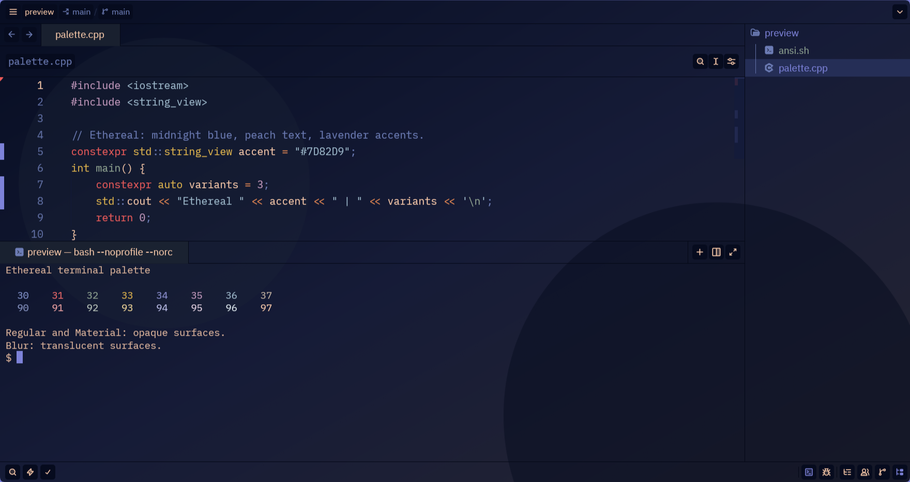
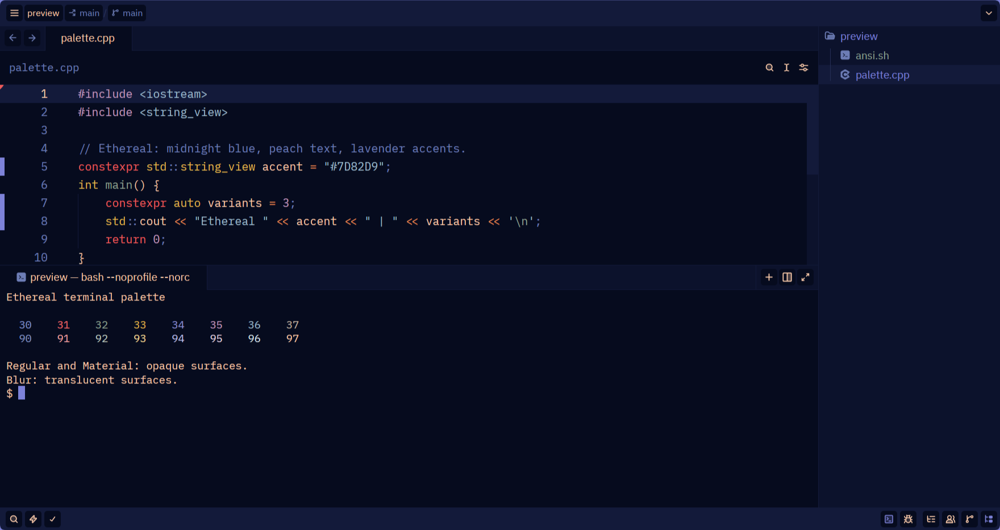
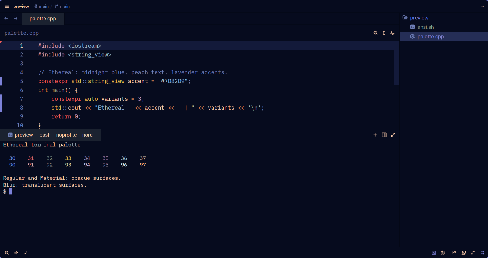

# Ethereal Theme for Zed

Omarchy's Ethereal palette for Zed: midnight blue backgrounds, peach text, and lavender accents. Three dark variants share the same syntax and terminal colors.

| Theme | Appearance |
| --- | --- |
| **Ethereal Blur** | Translucent editor and panels, with background blur requested from the window system. |
| **Ethereal Regular** | Opaque editor, lighter panels and title bar. |
| **Ethereal Material** | Opaque, uniform dark surfaces. |

## Preview

### Blur



### Regular



### Material



## Install

The extension has not yet been published to the Zed extension registry. Use one of the local installation methods below.

### Development extension

1. Clone this repository:

   ```sh
   git clone https://github.com/khdobromir/zed-ethereal.git
   ```

2. In Zed, run **zed: install dev extension** from the command palette and select the cloned directory.
3. Run **theme selector: toggle** and choose **Ethereal Blur**, **Ethereal Regular**, or **Ethereal Material**.

If you previously installed the JSON manually, move that copy out of Zed's `themes` directory first to avoid duplicate theme names.

### Manual installation

Copy `themes/ethereal.json` into Zed's user themes directory, then restart Zed or run **theme selector: reload**:

- Linux/macOS: `~/.config/zed/themes/`
- Windows: `%USERPROFILE%\AppData\Roaming\Zed\themes\`

Select a variant through the theme selector. To make Blur your dark theme:

```json
{
  "theme": {
    "mode": "dark",
    "light": "One Light",
    "dark": "Ethereal Blur"
  }
}
```

## Transparency and blur

Blur uses `background.appearance: "blurred"`, an `dd` alpha channel on the main background, and transparent editor and panel surfaces. The visible result depends on the operating system, compositor, wallpaper, and any window opacity rules. This extension does not configure your compositor.

Regular and Material use opaque theme surfaces. A compositor's separate window opacity rule can still make the whole window translucent.

## Development

Edit `themes/ethereal.json` directly. No Rust code or generator is required.

Validation needs Python 3.11 or later:

```sh
python3 -m venv .venv
.venv/bin/python -m pip install -r requirements-dev.txt
curl --fail --location https://zed.dev/schema/themes/v0.2.0.json -o theme-schema.json
.venv/bin/python scripts/check.py theme-schema.json
```

The check validates Zed's theme schema, extension metadata, all three variants, shared syntax colors, and the intended surface opacity. GitHub Actions runs it on pushes and pull requests.

## Credits and license

- Palette: [Ethereal in Omarchy](https://github.com/omacom/omarchy/tree/quattro/themes/ethereal), copyright David Heinemeier Hansson. [Original MIT license](LICENSES/Omarchy.txt).
- Theme structure and Blur, Regular, and Material styling: [Everforest for Zed](https://github.com/albertsko/zed-everforest) by Albert Skonieczny. [Original MIT license](LICENSES/Everforest.txt).
- Zed adaptation: Khristov Dobromir ([khdobromir](https://github.com/khdobromir)).

Distributed under the [MIT license](LICENSE). This is an independent adaptation.
